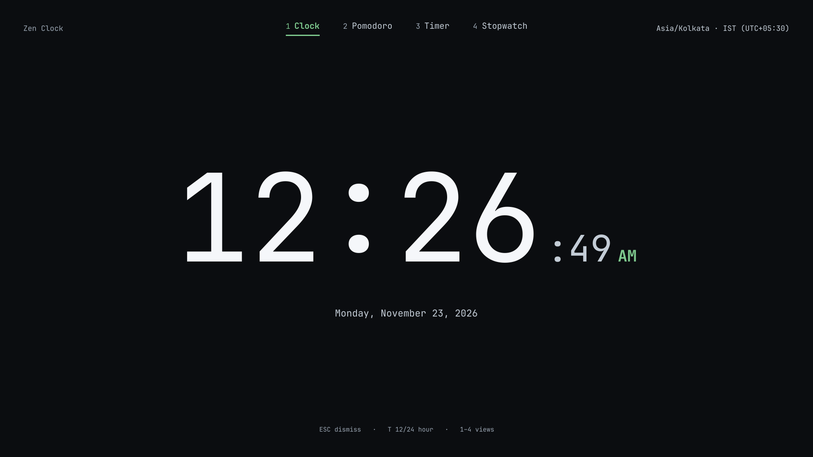
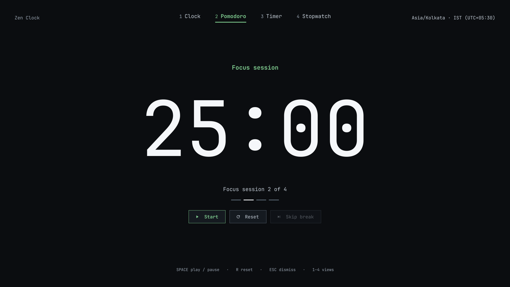
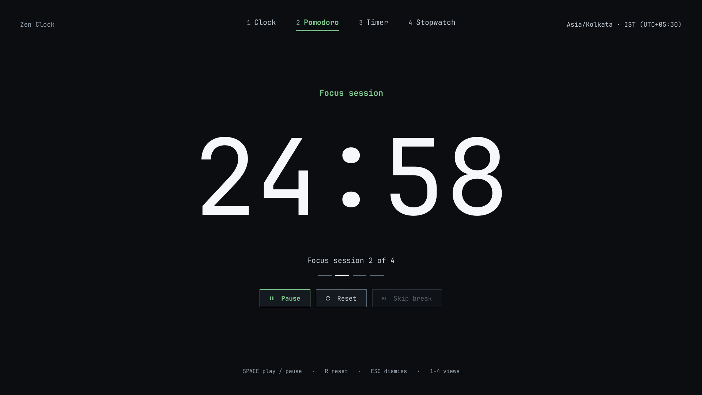
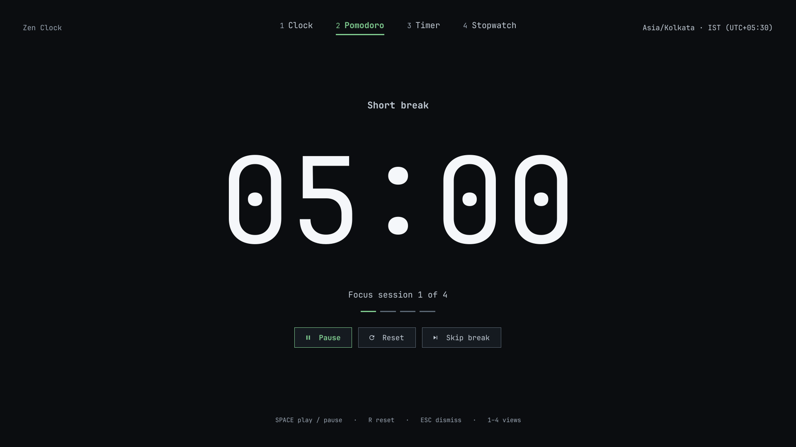
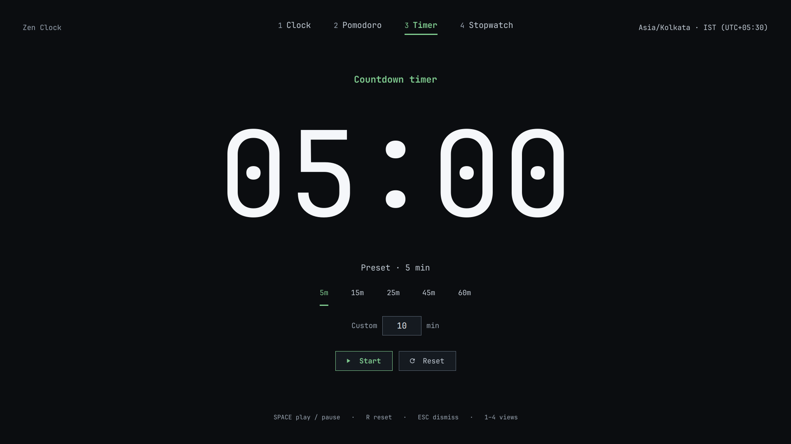
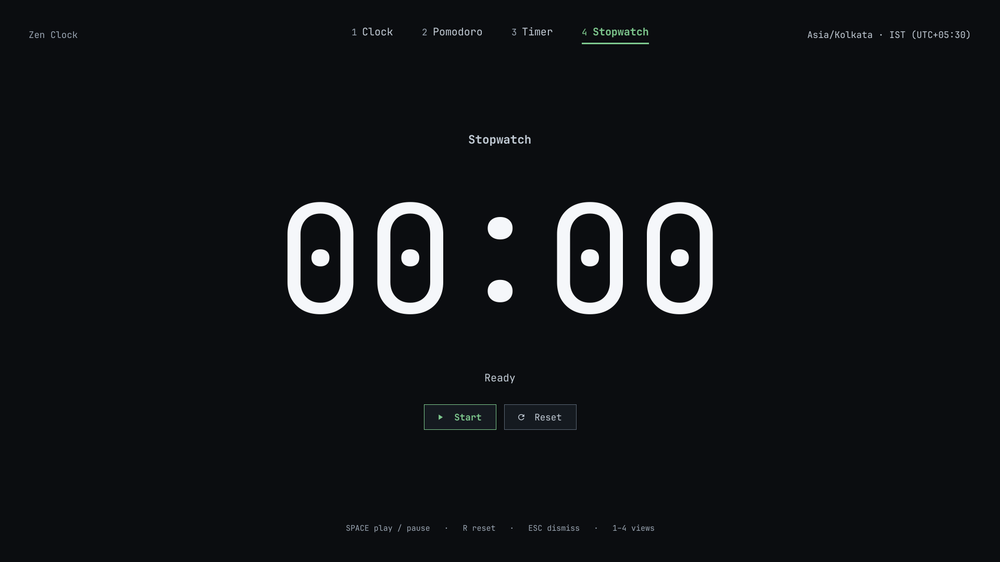

<div align="center">

# Zen Clock

**A distraction-free fullscreen HUD clock, Pomodoro engine, and productivity timer for Omarchy.**

One overlay. Four views. No dashboard to get lost in. Your focus work is saved to a local SQLite database you own and can query however you like.

[Install](#install) · [Screenshots](#screenshots) · [Focus Log](#focus-log-your-data-your-queries) · [Publishing](#publishing-to-the-omarchy-plugin-marketplace)

</div>

---

## Why Zen Clock

Most focus tools demand attention: dashboards, charts, streaks, pop-ups. Zen Clock does the opposite. It gives you a quiet fullscreen surface with the time and the one timer you care about, then fades out of the way while you work.

- **Four views, one keystroke apart** — Clock, Pomodoro, Countdown Timer, and Stopwatch (`1`–`4`).
- **Zen inactivity** — after a short grace period the HUD fades to black and the cursor blanks; the primary digits stay. Real input brings it back instantly, and a click on a faded control only reveals it, never activates it.
- **Timers live in the shell service** — closing the overlay does not stop a session or silence the chime. Re-summoning shows the exact live state.
- **Focus Log** — completed focus work is recorded in a versioned, client-local SQLite file. The published schema is the API: no SDK, no cloud, no lock-in.
- **Resume after anything** — pausing checkpoints the remaining time, phase, and cycle position. Shut down for a month and the button still says **Resume**.
- **Graceful degradation** — a corrupt or unwritable database never breaks the HUD. Timers and cues keep working; storage status is reported in `state()`.

## Screenshots

Real captures from the running plugin (1920×1080). Click any image to view it full size.

| | |
|:---:|:---:|
| [](docs/screenshots/01-clock.png) | [](docs/screenshots/02-pomodoro-focus.png) |
| *Clock — time, date, timezone, and the four-view selector* | *Pomodoro — focus session ready to start* |
| [](docs/screenshots/03-pomodoro-running.png) | [](docs/screenshots/04-short-break.png) |
| *Pomodoro — focus countdown running* | *Pomodoro — short break between focus sessions* |
| [](docs/screenshots/05-timer.png) | [](docs/screenshots/06-stopwatch.png) |
| *Timer — presets, custom minutes, and countdown* | *Stopwatch — elapsed time with lap-ready controls* |

## Install

Requires Omarchy with the Quickshell-based shell and Python 3 (standard library only).

```bash
omarchy plugin add https://github.com/PranavKumar9529desai/zenclock --enable
```

Or clone manually into `~/.config/omarchy/plugins/pranav.zenclock` and enable it:

```bash
omarchy plugin enable pranav.zenclock
```

`SUPER + Z` opens and closes the overlay. Saving a file in the plugin directory hot-reloads it; `omarchy-shell shell rescanPlugins` forces a reload if needed.

## Usage

| Key | Action |
|:---:|:---|
| `SUPER + Z` | Open / dismiss the overlay |
| `1` | Clock |
| `2` | Pomodoro |
| `3` | Countdown timer |
| `4` | Stopwatch |
| `SPACE` | Play / pause the active timer |
| `R` | Reset the active timer (or discard a restored checkpoint) |
| `T` | Toggle 12-hour / 24-hour time |
| `ESC` | Dismiss the overlay |

A Pomodoro Cycle is four 25-minute Focus Sessions with 5-minute Short Breaks, followed by a 30-minute Long Break. The cycle halts until you explicitly start a new one.

## Focus Log: your data, your queries

Every completed Focus Session, Pomodoro Cycle, and Timer countdown is recorded in a SQLite database at the documented Quickshell state path:

```text
Quickshell.statePath("zenclock/focus-log.sqlite3")
# typically ~/.local/state/zenclock/focus-log.sqlite3
```

The file is WAL-mode, so a dashboard can read it while Zen Clock writes. It stays on your machine — no telemetry, sync, or network access. The full contract is in [docs/focus-log-schema.md](docs/focus-log-schema.md); the design rationale is in [docs/adr/0003-focus-log-persistence.md](docs/adr/0003-focus-log-persistence.md).

**Canonical focus metric** — completed Focus Sessions only, using configured duration:

```sql
SELECT SUM(duration_minutes) AS focus_minutes FROM focus_record;
```

Breaks, Stopwatch time, and countdowns are deliberately excluded. Day boundaries are a query concern:

```sql
SELECT date(recorded_at / 1000, 'unixepoch', 'localtime') AS day,
       SUM(duration_minutes) AS minutes,
       COUNT(*) AS sessions
FROM focus_record
GROUP BY day
ORDER BY day;
```

A single checkpoint row remembers a paused session. It never expires, and retention defaults to keep-forever — pruning is a documented manual operation that never touches the checkpoint.

### Inspecting state

The overlay exposes a read-only `state()` payload over the shell IPC:

```bash
omarchy-shell shell call pranav.zenclock state ''
```

It includes the Focus Log path, schema version, WAL mode, record counts, storage status, checkpoint position, and current timer state.

## Development

```bash
scripts/check.sh                                   # JSON, shell, QML lint, plugin validation
python3 -m unittest discover -s tests -p 'test_*.py' # 30 unit tests
```

Live smoke tests drive the real shell through `tests/adapter.sh` and assert against the SQLite file, never the QML visual tree:

```bash
tests/smoke.sh               # overlay, timers, idle behavior
tests/focus-log.sh           # record writes, idempotency, dashboard queries
tests/focus-log-degraded.sh  # failure degradation
tests/checkpoint-resume.sh   # pause / resume / reset
```

Architecture notes live in [`docs/adr/`](docs/adr/), domain vocabulary in [`GLOSSARY.md`](GLOSSARY.md), and HUD timing rules in [`docs/BEHAVIOR.md`](docs/BEHAVIOR.md).

## Publishing to the Omarchy plugin marketplace

The marketplace does not host code — it lists a public repository. The recommended path:

1. **Prepare the repository** — keep installable files at the root (this repo already does), with a valid [`manifest.json`](manifest.json), this README, and a [license](LICENSE). No build step.
2. **Validate locally** — run `omarchy plugin validate .` and `scripts/check.sh`. The marketplace re-validates the exact commit at submission.
3. **Tag a release** — use a clean version tag (manifest currently declares `0.1.0`) so users can pin an install.
4. **Submit via the issue form** — [submit-plugin.yml](https://github.com/omacom/omarchy-plugin-marketplace/issues/new?template=submit-plugin.yml). Supply the repository URL, choose a category (productivity / utility), and up to three tags (clock, pomodoro, timer, focus).
5. **Wait for maintainer verification** — automated checks run first, then an `approved-and-verified` decision. The marketplace validates listings, not plugin security; plugins run unsandboxed, so keep dependencies minimal and documented.

Reference docs: [marketplace publishing guide](https://plugins.omarchy.org/publish.html) and the [Omarchy shell plugins manual](https://omarchy.org/manual/shell-plugins).

Users can also install directly from the repo URL at any time, without the marketplace.

## License

[MIT](LICENSE) — © Pranav Kumar Desai
